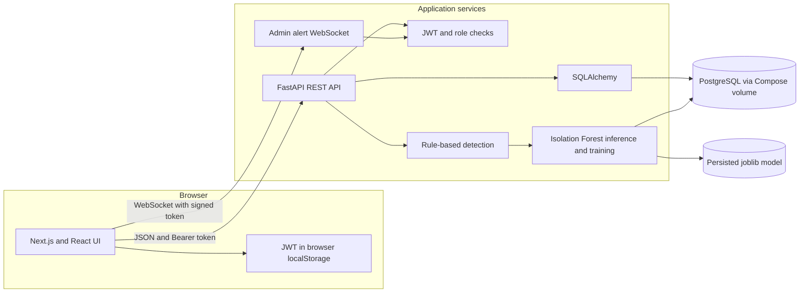
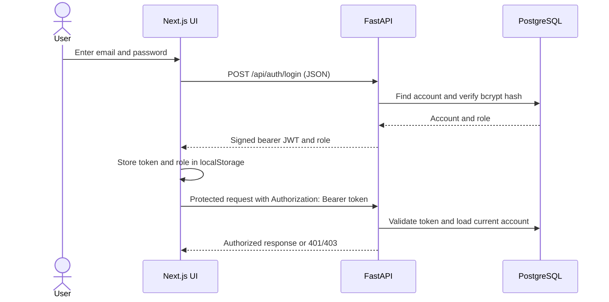
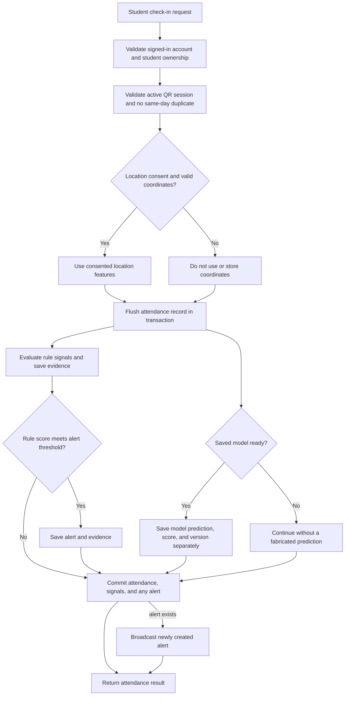

# Attendly – AI Attendance Anomaly Detector

Attendly is a full-stack attendance monitoring application for administrators and students. It records student check-ins, looks for unusual patterns using explicit rules, and can add a separate Isolation Forest prediction when a trained model is available. Administrators review evidence and decide how to handle alerts; an automated score is not proof of misconduct.

## Contents

- [Problem and objectives](#problem-and-objectives)
- [Features and limitations](#features-and-limitations)
- [Technology stack](#technology-stack)
- [Architecture and data flow](#architecture-and-data-flow)
- [Repository structure](#repository-structure)
- [Prerequisites](#prerequisites)
- [Configuration](#configuration)
- [Database and administrator setup](#database-and-administrator-setup)
- [Run the application](#run-the-application)
- [API reference](#api-reference)
- [Detection and machine learning](#detection-and-machine-learning)
- [Authentication and privacy](#authentication-and-privacy)
- [Tests and verification](#tests-and-verification)
- [Troubleshooting](#troubleshooting)
- [Screenshots](#screenshots)
- [Future enhancements](#future-enhancements)
- [Contributors, license, and references](#contributors-license-and-references)

## Problem and objectives

Manual attendance review can make it difficult to notice repeated device use, unexpected check-in times, unusual consented locations, or highly coordinated attendance patterns. Attendly provides a shared record of attendance and supporting evidence to help an administrator decide which entries need follow-up.

The project aims to:

- Provide administrator and student sign-in with role-based API access.
- Let administrators manage student records and create short-lived QR attendance sessions.
- Let students submit attendance for their own account and view their attendance history.
- Apply understandable rules to attendance events, record the evidence, and create reviewable alerts.
- Provide dashboard statistics, alert investigations, and CSV/PDF reports.
- Optionally train and persist an Isolation Forest model, expose its readiness, and attach genuine predictions to new attendance records.

### How Attendly works

1. An administrator signs in and creates an expiring attendance session, optionally tagged with a recurring course code.
2. A student signs in and submits the session code with their check-in. A student can only submit for their own account. The API rejects invalid/expired sessions and a second record for the same student on the same application-timezone date.
3. The API stores the record and evaluates device, consented-location, personal-timing, and recurring-session similarity signals. When a trained model is available, the API also records its prediction separately.
4. If the weighted rule score meets the configured alert threshold, Attendly stores an alert with evidence and can notify connected administrator clients over a WebSocket.
5. An administrator reviews the alert, records a note, and marks it reviewed, verified, dismissed, or escalated. Actions are retained in the investigation history.

## Features and limitations

| Area | Implemented behavior |
|---|---|
| Administrator access | Administrator accounts are created or reset with local CLI scripts; public registration cannot create an administrator. |
| Student accounts | Public registration is limited to the student role. A registration requires email, password, student code, and full name. Existing enrolled student codes must use their matching email. |
| Student directory | Administrators can list, add, edit, and deactivate students. Deactivation preserves the student record. |
| Attendance | Short-lived sessions can be issued as JSON codes or QR images. Attendance records are unique per student and application-timezone date. |
| Rule detection | Shared device identifiers, consented location deviation, unusual personal timing, and strict repeated similarity in a recurring session group are evaluated. |
| Risk classification | Rule points are capped at 100 and labeled low, medium, high, or critical. Alerts are created when the score meets `ALERT_THRESHOLD` (30 by default). |
| AI analytics | Administrators can train the Isolation Forest from attendance records, inspect model status, and view model predictions separately from rule risk. |
| Investigations | Alerts include evidence, notes, current status, and an administrator action history. |
| Reports | Attendance and alert reports can be downloaded as CSV or PDF. |
| Demo data | Administrators can seed a deterministic synthetic cohort through the dashboard or API. The seed endpoint does not replace an existing cohort of 500 or more students. |

### Limitations

- Detection identifies patterns for review; it cannot establish intent, identity, or fraud by itself.
- The Isolation Forest score is an unsupervised decision score, **not a fraud probability**. Training diagnostics are calculated on the training records and are not held-out performance estimates.
- Location is optional and only used when `location_consent` is true and valid coordinates are supplied. Campus distance is a configurable reference; location can be inaccurate.
- Student registration checks the email against an existing student only when the submitted student code already exists. If the code is unknown, the current API creates a student record; this is not a verified enrollment/invitation workflow.
- Device identifiers are supplied by clients and are not cryptographic hardware identities.
- Similarity detection requires a shared recurring course/session group and multiple very close matches; ordinary shared schedules are not sufficient.
- The application uses local-development CORS, database, and Compose defaults. They are not production deployment settings.
- There is no dedicated frontend unit or browser end-to-end test suite in this repository.

## Technology stack

| Layer | Technologies actually used |
|---|---|
| Frontend | Next.js 15 App Router, React 19, TypeScript 5, Tailwind CSS 4, Recharts, and Lucide React |
| Backend | Python 3.12, FastAPI, Uvicorn, Pydantic settings and validation |
| Database | PostgreSQL 16 in Docker Compose; SQLAlchemy 2 ORM; Psycopg 3 driver; Alembic migrations. SQLite is also supported by the database configuration for local/testing use. |
| Authentication | Signed JWTs using `python-jose`, HTTP Bearer authentication, Passlib with bcrypt password hashing |
| Machine learning | NumPy, scikit-learn `IsolationForest`, `SimpleImputer`, `StandardScaler`, and joblib serialization |
| Other backend libraries | `qrcode`/Pillow for QR images, ReportLab for PDF reports, `requests` for the demo-data client, and pandas (declared in requirements; not imported by the current application code) |
| API | JSON REST endpoints, OpenAPI/Swagger UI, one admin alert WebSocket |
| Containers | Docker images and Docker Compose |
| Tests | Pytest, FastAPI `TestClient`, HTTPX, SQLite-backed test fixtures; frontend production verification uses `next build` |

The model feature extraction uses NumPy and SQLAlchemy records. Pandas is listed in `requirements.txt`, although the current application code does not import it.

## Architecture and data flow

### Overall system



The browser calls `http://localhost:8000` by default. In Compose, the browser-facing frontend is published on port 3000, the API on port 8000, and the database on host port 5432. The API reaches PostgreSQL by the Compose service name `db` on port 5432. The database files live in the named `attendance_pg` volume. The model artifact is mounted from the host's `model_artifacts/` directory into the API container.

The ORM schema centers on `students`, `users`, `attendance_sessions`, and `attendance_records`. A user can optionally reference a student; attendance records reference students and are unique per student/date. `suspicious_alerts` reference the attendance that triggered them; `anomaly_events` store individual rule evidence, while `investigation_notes` and `admin_actions` retain follow-up and status history. `model_metadata` records training runs and readiness details. The schema also defines `devices` and `student_location_history`; the active detection implementation currently derives shared-device and location baselines from attendance records rather than requiring those tables to be populated.

### Authentication flow



JWT lifetime is `ACCESS_TOKEN_MINUTES` (720 minutes by default). The API checks the token and loads the account for protected HTTP requests; administrator-only dependencies also check the account's database role.

### Attendance and anomaly workflow



## Repository structure

```text
.
├── app/                                  # Next.js App Router frontend source
│   ├── globals.css                       # Global styles
│   ├── layout.tsx                        # Root HTML/layout metadata
│   └── page.tsx                          # Login, student view, admin dashboard and UI modules
├── backend/
│   ├── app/
│   │   ├── config.py                     # Environment settings and application timezone
│   │   ├── database.py                   # SQLAlchemy engine and sessions
│   │   ├── detection.py                  # Rule signals, evidence, scoring and alert creation
│   │   ├── main.py                       # FastAPI routes and WebSocket
│   │   ├── ml.py                         # Isolation Forest features, training and inference
│   │   ├── models.py                     # SQLAlchemy database models
│   │   ├── schemas.py                    # Pydantic request schemas
│   │   └── security.py                   # Password hashing, JWT and role dependencies
│   ├── migrations/
│   │   ├── env.py                        # Alembic database configuration
│   │   └── versions/                     # Versioned database migrations
│   ├── tests/                            # API, detection, scoring and ML tests
│   ├── Dockerfile                        # Backend image
│   └── attendance.db                     # Local SQLite file if created; ignored by Git
├── frontend/
│   └── Dockerfile                        # Frontend image; Next.js source remains at repository root
├── model_artifacts/                      # Compose bind mount for saved joblib model (ignored)
├── scripts/
│   ├── create_admin.py                   # Create a first administrator account
│   ├── generate_demo_data.py             # Call API to seed demo records
│   └── reset_admin_password.py           # Reset an existing administrator password
├── .env.example                          # Safe-to-copy configuration template
├── alembic.ini                           # Alembic configuration
├── docker-compose.yml                    # PostgreSQL, API, and frontend services
├── next.config.ts                        # Next.js config
├── package.json / package-lock.json      # Node dependencies and scripts
├── requirements.txt                      # Python dependencies
└── README.md
```

The local model default path is `backend/models/isolation_forest.joblib`. Compose sets `ATTENDANCE_MODEL_PATH=/project/backend/models/isolation_forest.joblib` and persists that directory through `model_artifacts/`. The model file is ignored by Git and is created/updated when training succeeds.

## Prerequisites

- **Python 3.12** is recommended and used by the backend Docker image.
- **Node.js 20+ and npm** are used by the frontend image and package lockfile.
- **Docker Desktop with Docker Compose** is the simplest way to run PostgreSQL or the whole application.
- For a manual backend with PostgreSQL, use PostgreSQL 16 or another compatible PostgreSQL release and configure `DATABASE_URL`.
- **Git** is required only to clone the repository. No repository URL is included in this project, so replace `<repository-url>` below with the URL provided by the project owner.

Install Python, Node.js, Git, and Docker Desktop from their official installers if they are not already available: [Python downloads](https://www.python.org/downloads/), [Node.js downloads](https://nodejs.org/en/download), [Git downloads](https://git-scm.com/downloads), and [Docker Desktop](https://www.docker.com/products/docker-desktop/). On macOS, Homebrew users can also install Git with `brew install git`.

Clone the repository using the URL supplied by the project owner, then open the project root:

```bash
git clone <repository-url>
cd <repository-directory>
```

## Configuration

The backend reads the repository-root `.env` file regardless of whether the process starts from the repository root or `backend/`. Environment variables supplied by the process override `.env`. Docker Compose passes `.env` to the API and overrides its database URL with the internal hostname `db`.

Create `.env` only if one is not already present; this avoids overwriting local configuration.

**macOS / Linux:**

```bash
if [ ! -f .env ]; then cp .env.example .env; fi
```

**Windows PowerShell:**

```powershell
if (-not (Test-Path .env)) { Copy-Item .env.example .env }
```

Edit `.env` and replace the placeholder `SECRET_KEY` with a long random value. You can generate one locally with:

```bash
python -c "import secrets; print(secrets.token_urlsafe(48))"
```

Paste the generated value into `.env`; do not commit `.env`, paste secrets into issue reports, or put real credentials in source control. `.env.example` is a template, not a secure deployment configuration.

### Environment variables

| Variable | Purpose | Default / example |
|---|---|---|
| `DATABASE_URL` | SQLAlchemy database connection. Host tools use `localhost`; Compose overrides this to `db:5432`. | `postgresql+psycopg://<user>:<password>@localhost:5432/<database>` |
| `SECRET_KEY` | Signs and verifies JWTs. Set a unique, long random value. | Placeholder in `.env.example`; unsafe development fallback exists in code if unset. |
| `ACCESS_TOKEN_MINUTES` | JWT expiration. | `720` |
| `ALERT_THRESHOLD` | Minimum rule score for creating an alert. | `30` |
| `CAMPUS_LATITUDE`, `CAMPUS_LONGITUDE` | Campus reference for consented-location distance. | Example coordinates in `.env.example`; replace with campus-approved values. |
| `QR_TTL_SECONDS` | Lifetime for a newly created QR session. | `120` |
| `APP_TIMEZONE` | Timezone used for attendance-day boundaries. | `UTC` |
| `WEIGHT_DEVICE_SHARING` | Points for a shared-device signal. | `30` |
| `WEIGHT_LOCATION` | Points for a location signal. | `25` |
| `WEIGHT_TIMING` | Points for a personal timing signal. | `15` |
| `WEIGHT_SIMILARITY` | Points for a recurring-session similarity signal. | `20` |
| `WEIGHT_OTHER` | Reserved score breakdown weight; no separate `other` signal is currently generated. | `10` |
| `ATTENDANCE_MODEL_PATH` | Optional model artifact path; Compose sets it. | `backend/models/isolation_forest.joblib` locally |
| `NEXT_PUBLIC_API_URL` | API URL used by the browser frontend. | `http://localhost:8000` |

The actual backend variables and example values are in [`.env.example`](.env.example). `NEXT_PUBLIC_API_URL` is set in Compose and otherwise defaults in the frontend code to `http://localhost:8000`. Because it is a public frontend variable, never put a secret in it. When changing the API URL for a production frontend build, set it at build time and rebuild the frontend image.

Reference template (replace the database placeholders with values for your PostgreSQL instance):

```dotenv
DATABASE_URL=postgresql+psycopg://<db_user>:<db_password>@localhost:5432/<db_name>
SECRET_KEY=replace-with-a-long-random-secret
ACCESS_TOKEN_MINUTES=720
ALERT_THRESHOLD=30
CAMPUS_LATITUDE=37.4275
CAMPUS_LONGITUDE=-122.1697
QR_TTL_SECONDS=120
APP_TIMEZONE=UTC
WEIGHT_DEVICE_SHARING=30
WEIGHT_LOCATION=25
WEIGHT_TIMING=15
WEIGHT_SIMILARITY=20
WEIGHT_OTHER=10
NEXT_PUBLIC_API_URL=http://localhost:8000
```

This is documentation only; the repository's actual `.env.example` is the copyable file. Replace the angle-bracket database values before connecting, and URL-encode reserved characters in database usernames/passwords.

## Database and administrator setup

### PostgreSQL with Docker Compose

The Compose database service is PostgreSQL 16 and stores its data in the named `attendance_pg` volume. Start only the database for manual development:

```bash
docker compose up -d db
docker compose ps
```

Compose exposes the database on `localhost:5432`. The backend container connects internally using `db:5432`. The database username/password configured in `docker-compose.yml` are development defaults; change them and the API connection configuration before deploying outside a local development environment.

### Migrations

With the Python environment activated and the working directory set to the repository root:

```bash
alembic upgrade head
```

Alembic applies the versioned migrations in `backend/migrations/versions/`. The API Docker entrypoint runs `alembic upgrade head` before starting Uvicorn. The initial schema migration is `0001_initial`; `0002_ml_audit_similarity` adds course grouping, per-record model predictions, model metadata, and administrator action status fields.

### Administrator account

Create an administrator only when one does not already exist. The script prompts for a password without echoing it:

```bash
# From the repository root, after the backend virtual environment is installed
backend/.venv/bin/python scripts/create_admin.py admin@college.edu
```

Windows PowerShell:

```powershell
.\backend\.venv\Scripts\python.exe scripts\create_admin.py admin@college.edu
```

In Compose, after the API is running:

```bash
docker compose exec api python /project/scripts/create_admin.py admin@college.edu
```

For an existing administrator, use the reset utility; it updates the existing admin row and does not create a duplicate:

```bash
backend/.venv/bin/python scripts/reset_admin_password.py admin@college.edu
```

Windows PowerShell:

```powershell
.\backend\.venv\Scripts\python.exe scripts\reset_admin_password.py admin@college.edu
```

Compose:

```bash
docker compose exec api python /project/scripts/reset_admin_password.py admin@college.edu
```

The reset utility asks for and confirms a password interactively, enforces the existing bcrypt password-length constraints, and hashes it using the same Passlib configuration as login. Do not pass a password on the command line.

### Demo data

After signing in as an administrator, use **Generate demo data** in the dashboard, or call the admin-only `POST /api/demo/seed` endpoint. There is also `scripts/generate_demo_data.py`; it requires `ADMIN_EMAIL` and `ADMIN_PASSWORD` environment variables and calls the API. Prefer the dashboard or Swagger UI so you do not put a password into shell history.

The project does not include a database-reset command. `docker compose down -v` deletes the PostgreSQL data volume and should not be used when data must be retained. `docker compose down` stops containers but keeps the named volume.

## Run the application

### Manual development on macOS / Linux

Run PostgreSQL in the first terminal and create a `.env` as described above. In a backend terminal, start in the backend directory and create the virtual environment there:

```bash
cd backend
python3.12 -m venv .venv
source .venv/bin/activate
cd ..
docker compose up -d db
python -m pip install --upgrade pip
pip install -r requirements.txt
alembic upgrade head
cd backend
```

Start the backend in the same terminal (or a new terminal with the environment activated):

```bash
uvicorn app.main:app --reload --host 0.0.0.0 --port 8000
```

The backend is at `http://localhost:8000`. Interactive Swagger documentation is at `http://localhost:8000/docs`; ReDoc is at `http://localhost:8000/redoc`.

In a separate terminal, from the repository root (the Next.js app source is `app/`, not `frontend/`):

```bash
npm ci
NEXT_PUBLIC_API_URL=http://localhost:8000 npm run dev
```

The frontend is at `http://localhost:3000`.

### Manual development on Windows PowerShell

Start PostgreSQL, open PowerShell in the repository root, and use a backend terminal:

```powershell
if (-not (Test-Path .env)) { Copy-Item .env.example .env }
Set-Location backend
py -3.12 -m venv .venv
.\.venv\Scripts\Activate.ps1
Set-Location ..
docker compose up -d db
python -m pip install --upgrade pip
pip install -r requirements.txt
alembic upgrade head
Set-Location backend
```

If PowerShell blocks virtual-environment activation, either use a permitted activation policy for your user or invoke `.venv\Scripts\python.exe` and `.venv\Scripts\uvicorn.exe` directly while in `backend/`.

Start the backend:

```powershell
uvicorn app.main:app --reload --host 0.0.0.0 --port 8000
```

In another PowerShell terminal, from the repository root:

```powershell
npm ci
$env:NEXT_PUBLIC_API_URL = "http://localhost:8000"
npm run dev
```

Open `http://localhost:3000`; API docs are at `http://localhost:8000/docs`.

### Run the full stack with Docker Compose

Copy `.env.example` only if `.env` is absent, set a unique `SECRET_KEY`, and run from the repository root:

```bash
docker compose up --build -d
docker compose ps
docker compose logs --tail=100 api db web
```

The frontend is served at `http://localhost:3000`, the API at `http://localhost:8000`, and the host-mapped database at `localhost:5432`. Compose waits for PostgreSQL's health check before starting the API, runs migrations automatically in the API container, then waits for the API health check before starting the frontend. The browser must use `http://localhost:8000`; the API uses the Compose hostname `db` only for its PostgreSQL connection. Start all three services with `docker compose up --build -d`. If you intentionally stopped the API container, start it again with `docker compose up -d api`. Do not start a second Uvicorn process on port 8000 while the Compose API is running.

Stop without deleting database data:

```bash
docker compose down
```

## API reference

The API uses JSON over HTTP unless noted. `Authorization: Bearer <JWT>` is required for protected routes. The most complete interactive schema is at `/docs` while the API is running; OpenAPI JSON is `/openapi.json`.

### Authentication

| Method and path | Access | Purpose and request |
|---|---|---|
| `GET /api/health` | Public | Returns `{"status":"ok"}`. |
| `POST /api/auth/login` | Public | JSON body `{"email":"admin@example.edu","password":"<password>"}`. Returns `access_token`, `token_type`, `role`, and `student_id` (null for an admin). |
| `POST /api/auth/register` | Public, student role only | Requires email and password; `role` defaults to `student`. Student registration also requires `student_code` and `full_name`. Returns a bearer token and role. Cannot provision an administrator. |

Login example (use a password locally; do not commit real credentials):

```bash
curl -X POST http://localhost:8000/api/auth/login \
  -H 'Content-Type: application/json' \
  -d '{"email":"admin@example.edu","password":"<your-password>"}'
```

### Students

| Method and path | Access | Purpose and key inputs |
|---|---|---|
| `GET /api/students?search=&limit=50&offset=0` | Admin | Paginated directory; optional search matches student code/name. |
| `POST /api/students` | Admin | JSON `student_code`, `full_name`, `email`, optional `department`. |
| `GET /api/students/{student_id}` | Admin or that student | Fetch student details. |
| `PUT /api/students/{student_id}` | Admin | Replace editable student fields using the `StudentCreate` body. |
| `DELETE /api/students/{student_id}` | Admin | Deactivates the student; it does not delete the row. |

### Attendance

| Method and path | Access | Purpose and key inputs |
|---|---|---|
| `POST /api/attendance/session?course_code=BIO101` | Admin | Creates an expiring session. `course_code` is optional and identifies a recurring group for similarity checks. Returns `session_code`, `expires_at`, and `ttl_seconds`. |
| `POST /api/attendance/session/qr?course_code=BIO101` | Admin | Same session creation as a PNG QR response. Session code and expiration are returned in `X-Session-Code` and `X-Expires-At` headers. |
| `POST /api/attendance/mark` | Signed-in admin or the student themselves | Body includes `student_id`, `session_code`, optional `device_identifier`, `location_consent`, `latitude`, and `longitude`; optional `source` and admin-only `checked_in_at` are defined in `AttendanceCreate`. Student requests must use an active QR session and cannot submit for another student. |
| `POST /api/attendance/demo?student_id=1&case=normal` | Admin | Submits a synthetic example through the current detection engine. Supported cases in the UI: `normal`, `shared_device`, `unusual_location`, `unusual_timing`, `similarity`, `combined`. This writes demo attendance records. |
| `GET /api/attendance?limit=100&offset=0` | Admin | Paginated attendance records. |
| `GET /api/attendance/student/{student_id}` | Admin or that student | Attendance history for one student. |
| `GET /api/attendance/{attendance_id}` | Admin | Attendance details, consented coordinates, and any stored model prediction. |

The check-in body is validated by `AttendanceCreate` in [`backend/app/schemas.py`](backend/app/schemas.py). Location coordinates are discarded if consent is false. Duplicate student/day records return `409`.

### Alerts and investigations

| Method and path | Access | Purpose and key inputs |
|---|---|---|
| `GET /api/alerts` | Admin | Filters: `risk`, `status`, `student_id`, `search`, `date_from`, `date_to`, `limit`, and `offset`. Returns `items` and `total`. |
| `GET /api/alerts/{alert_id}` | Admin | Alert, evidence, related attendance/student, investigation notes, and action history. |
| `POST /api/alerts/{alert_id}/review` | Admin | Optional JSON `{"note":"..."}`; marks the alert reviewed and records the action. |
| `POST /api/alerts/{alert_id}/verify` | Admin | Optional note; marks verified and records the action. |
| `POST /api/alerts/{alert_id}/dismiss` | Admin | Optional note; marks dismissed and records the action. |
| `POST /api/alerts/{alert_id}/escalate` | Admin | Optional note; marks escalated and records the action. |

### Analytics, AI, reports, demo, and real-time

| Method and path | Access | Purpose and key inputs |
|---|---|---|
| `GET /api/analytics/dashboard` | Admin | Dashboard counts, recent alerts, attendance by day, and severity distribution. |
| `GET /api/analytics/anomalies` | Admin | Alert totals and counts by `device_sharing`, `location`, `timing`, and `similarity`. |
| `GET /api/analytics/risk-distribution` | Admin | Counts for low, medium, high, and critical alerts. |
| `POST /api/ai/analyze/{attendance_id}` | Admin | Re-evaluates rule evidence for an attendance record and returns rule score/severity plus any separate stored model prediction. |
| `GET /api/ai/model-status` | Admin | Model file/load/training/prediction readiness, version, feature names, record count, and last training state. |
| `POST /api/ai/train` | Admin | Trains and persists the Isolation Forest using eligible attendance records; returns metadata and training diagnostics. |
| `GET /api/reports/{kind}?format=csv` | Admin | `kind` is `attendance` or `alerts`; `format` is `csv` (default) or `pdf`. Returns a downloadable report. |
| `POST /api/demo/seed` | Admin | Creates missing records for the reproducible 500-student synthetic cohort unless the database already has at least 500 students. |
| `WS /api/ws/alerts?token=<JWT>` | Admin JWT | Receives newly generated alert messages. The implementation supplies the signed token as a WebSocket query parameter. |

Common errors include `400` for invalid report format or invalid session state, `401` for missing/invalid/expired credentials or incorrect login, `403` for role/ownership failures, `404` for missing records, `409` for duplicate accounts/check-ins, and `422` for request validation or insufficient/unsuitable model training data. A training infrastructure failure returns `500`; the previous model artifact is preserved if training does not complete.

## Detection and machine learning

### Rule-based detection

Rules operate when an attendance record is submitted. Each active signal contributes its configured weight once; the score is capped at 100. The default weights and severity ranges are:

| Signal | Default points | Implemented condition |
|---|---:|---|
| Device sharing | 30 | Same supplied device identifier appears for a different student within 15 minutes. |
| Location | 25 | With consent and valid coordinates, campus distance exceeds 2 km or (when enough history exists) distance from the student's mean of consented prior locations exceeds 2 km. At least 3 valid historical samples are required for the personal baseline. |
| Timing | 15 | With at least 4 prior check-ins, the current UTC check-in minute differs from the circular personal baseline by more than 150 minutes. |
| Similarity | 20 | Same recurring `session_group`; at least 5 of the student's own prior records in that group; peer date-set Jaccard score at least 0.90; check-in within one minute on at least 80% of shared dates; and distinct device identifiers. |

| Rule score | Severity |
|---:|---|
| 0–29 | Low |
| 30–49 | Medium |
| 50–74 | High |
| 75–100 | Critical |

An alert is created when at least one signal exists and the total meets `ALERT_THRESHOLD` (30 by default). Rule scores are explainable evidence points, **not probabilities**. The `WEIGHT_OTHER` setting is present for score breakdown compatibility, but no separate `other` rule is currently generated.

Naive database timestamps are interpreted as UTC. The application date used to enforce one attendance record per day follows `APP_TIMEZONE` (UTC by default). Similarity comparisons only use records with an explicit recurring course/session group; ordinary calendar overlap is not enough.

### Isolation Forest model

Model implementation lives in [`backend/app/ml.py`](backend/app/ml.py). Training is available from the administrator's **AI Analytics** view or the admin-only API `POST /api/ai/train`; there is no standalone model-training script.

Training procedure:

1. Read eligible attendance records ordered by timestamp.
2. Require at least 20 valid records and some feature variation; otherwise the API returns `422` with the reason.
3. Build six features: circular check-in minute (`sin` and `cos`), count of other students sharing a device in a 15-minute window, consented distance from campus, rolling attendance count in seven days, and personal timing deviation after at least four prior records.
4. Keep unavailable/unauthorized location and insufficient-history timing values missing, then use median imputation and standard scaling in an sklearn pipeline.
5. Fit `IsolationForest(n_estimators=256, contamination=0.05, random_state=42)`.
6. Serialize to a temporary file, verify it, and atomically replace the configured artifact. Store version, feature list, training metadata, and training-set diagnostics in `model_metadata`.

For Compose, the model is persisted in the host directory `model_artifacts/`. The API status endpoint reports `is_trained`, `is_loaded`, `model_file_exists`, `prediction_ready`, model version, status, and error details. A missing model does not produce a made-up prediction; attendance processing continues with no model output. An unreadable artifact is reported as unavailable.

Predictions use `-1` for an Isolation Forest outlier and `1` for an inlier. `anomaly_score` is the negative `decision_function` output; higher values are more outlier-like, but it is an **uncalibrated model score, not a probability of fraud**. The rule score and model output are stored and displayed separately; the model score does not add points to the alert's rule score.

Training diagnostics, when labeled data is present, are computed on the training rows themselves. They are not a holdout or independent evaluation. The contamination setting is a model configuration and is not evidence that exactly that proportion of real attendance is fraudulent.

Train using the dashboard, or in Swagger:

1. Sign in with `POST /api/auth/login` and use the returned token with the **Authorize** button.
2. Call `POST /api/ai/train`.
3. Call `GET /api/ai/model-status` to confirm readiness.

The same calls can be made with `curl` after setting a valid token in a local shell variable:

```bash
export TOKEN='<admin-jwt-from-login-response>'
curl -X POST http://localhost:8000/api/ai/train \
  -H "Authorization: Bearer $TOKEN"
curl http://localhost:8000/api/ai/model-status \
  -H "Authorization: Bearer $TOKEN"
unset TOKEN
```

Do not paste real tokens into committed files, screenshots, or shared logs.

## Authentication and privacy

- Passwords are hashed with Passlib's bcrypt scheme. Login returns a signed JWT; the UI stores it in browser `localStorage` and sends it in the `Authorization: Bearer` header for protected API calls.
- HTTP authentication validates the JWT signature and expiration, loads the user, and checks the user's stored role for administrator routes. Students may only access their own student record/history and submit attendance for themselves.
- Public registration is student-only. Admin accounts are provisioned through `scripts/create_admin.py`; `scripts/reset_admin_password.py` updates an existing admin account without creating a new one.
- The `User` model does not have an active/inactive field. The student model does; student deactivation preserves the record.
- Coordinates are only stored/used when `location_consent` is true. API responses hide stored coordinates if the record is not marked consented. Students can deny browser location permission and still check in.
- Device identifiers are optional, client-supplied identifiers. Avoid collecting identifiers beyond an appropriate consent and retention policy.
- Use HTTPS/WSS, a strong unique secret, restricted database access, backups, and a secrets manager before any non-local deployment. The Compose database credentials and example campus coordinates are development defaults.
- The alert WebSocket receives the JWT in a query string. Reverse proxies/access logs must be configured not to record sensitive query strings, or the implementation should be changed to a safer token transport before deployment.
- Anomaly alerts require human review and appropriate institutional process. Do not use the model alone to make disciplinary decisions.

## Tests and verification

Backend tests use Pytest and FastAPI `TestClient`; test fixtures create isolated SQLite databases. They cover authentication and role checks, request/API behavior, duplicate attendance, detection evidence, alert history, model training/serialization/prediction, and related failure cases.

From the repository root with dependencies installed:

```bash
DATABASE_URL=sqlite:// backend/.venv/bin/pytest backend/tests -q
npm run build
```

Windows PowerShell:

```powershell
$env:DATABASE_URL = "sqlite://"
.\backend\.venv\Scripts\pytest.exe backend\tests -q
Remove-Item Env:DATABASE_URL
npm run build
```

When running with Docker Compose:

```bash
docker compose run --rm -e DATABASE_URL=sqlite:// --entrypoint pytest api backend/tests -q
```

The tests are pointed at SQLite explicitly to avoid touching the configured PostgreSQL database during import or test setup. The expected backend result is a passing Pytest summary; the frontend verification is a successful Next.js production build with lint/type validation performed by `next build`. There is no configured Jest, Vitest, Playwright, or Cypress suite, and the test suite is not a test of a production PostgreSQL deployment.

## Troubleshooting

### Backend does not start

Check Python version, environment, migration output, and logs:

```bash
python --version
docker compose logs --tail=100 api db
docker compose ps
```

For manual runs, start from the repository root or use the documented `--app-dir backend` command. The backend loads `.env` from the repository root regardless of current directory. Run `alembic upgrade head` after activating the backend environment.

### Frontend does not start or cannot reach the API

```bash
node --version
npm --version
npm ci
```

Confirm that the API is reachable at `http://localhost:8000/api/health` and the frontend is using `NEXT_PUBLIC_API_URL=http://localhost:8000`. For a non-default API address, set the frontend variable before starting `npm run dev`; for a Docker production build, set it during image build and rebuild. Check the browser console for the failing request URL.

### Python dependency or pandas build error

Use Python 3.12 and update pip in the virtual environment before installing requirements. Pandas, NumPy, and scikit-learn versions are pinned in `requirements.txt`; current application code imports NumPy/scikit-learn for model work but does not import pandas. If a pandas build tries compiling from source, verify Python is 3.12, upgrade pip, and retry installation in a clean environment. On Windows, use 64-bit Python compatible with the pinned wheels.

### Database connection refused or wrong data appears

Start the Compose database and inspect its health:

```bash
docker compose up -d db
docker compose ps
docker compose exec db pg_isready
```

Manual backend processes connect to the host-mapped database through the root `.env` `DATABASE_URL` (normally `localhost:5432`). The API container connects to Compose hostname `db:5432`. Do not point one process at SQLite and another at PostgreSQL if they must share records. Check the sanitized host/database portion of `DATABASE_URL` without printing its password.

### Port already in use

Change the API port with Uvicorn's `--port` option and update `NEXT_PUBLIC_API_URL`. Next.js can use another development port with `npm run dev -- --port 3001`; update the API CORS configuration and browser URL if using a different frontend origin. Compose publishes fixed host ports 3000, 8000, and 5432; edit the port mapping if needed.

macOS/Linux diagnostics:

```bash
lsof -nP -iTCP:8000 -sTCP:LISTEN
lsof -nP -iTCP:3000 -sTCP:LISTEN
```

Windows PowerShell:

```powershell
Get-NetTCPConnection -LocalPort 8000 -State Listen
Get-NetTCPConnection -LocalPort 3000 -State Listen
```

### Incorrect email or password / HTTP 401

The API intentionally returns the same login error for an unknown email and a wrong password. Confirm the backend points at the intended PostgreSQL database, then reset the existing admin password through the hidden-input CLI prompt:

```bash
backend/.venv/bin/python scripts/reset_admin_password.py admin@college.edu
```

Restart the manually running backend after configuration changes. Do not create a second administrator as a password-recovery workaround. A `401` on protected endpoints means the bearer token is missing, invalid, or expired; log in again and send the new token.

### HTTP 403 or 422

- `403` means the signed-in account does not have the required role or is attempting to access another student's data.
- `422` commonly means a body/query value is missing or invalid. Read FastAPI's response `detail` for field errors. Model training also uses `422` when fewer than 20 valid attendance records or insufficient feature variation is available.

### CORS errors

The backend currently allows the origin `http://localhost:3000`. Use that exact origin during local development. Accessing the frontend as `http://127.0.0.1:3000` is a different origin and is not in the configured allowlist.

### Missing environment values

Create `.env` from `.env.example` only when it is absent and set a strong `SECRET_KEY`. Compose requires a `.env` file because the API service declares it as `env_file`. The frontend API URL is public configuration, not a secret. Restart services after changing environment variables.

### Model is missing or training fails

Check `GET /api/ai/model-status`. If `prediction_ready` is false because no model file exists, train through the AI Analytics view or `POST /api/ai/train`. Training needs at least 20 valid records with feature variation. Check `training_status` and `error_message` for the reported reason. Confirm the artifact directory is writable and, with Compose, that `model_artifacts/` is mounted. Missing model output does not block attendance; it means no model prediction is attached.

### Docker issues

```bash
docker compose ps
docker compose logs --tail=100 db api web
docker compose up --build -d
```

If PostgreSQL is still starting, wait until its health check passes and inspect API logs. Avoid `docker compose down -v`; it removes the persistent database volume.

## Screenshots

No application screenshots are included in the repository. Add real, current screenshots under a new `docs/screenshots/` directory when available; do not use mockups as if they were application captures.

Suggested screenshots:

- `docs/screenshots/login.png` — login page.
- `docs/screenshots/admin-dashboard.png` — administrator dashboard and statistics.
- `docs/screenshots/students.png` — student management.
- `docs/screenshots/attendance-qr.png` — attendance and QR-session workflow.
- `docs/screenshots/alerts-investigation.png` — alerts, evidence, and investigation controls.
- `docs/screenshots/ai-analytics.png` — model status and training screen.
- `docs/screenshots/reports.png` — attendance and alert report controls.

After capturing them, embed the real images here using relative Markdown paths, such as the administrator dashboard capture saved as `docs/screenshots/admin-dashboard.png`.

## Future enhancements

These are ideas, not current features:

- Add browser-based end-to-end tests for administrator and student flows.
- Evaluate model quality with time-based holdout data and institution-reviewed labels.
- Add configurable, tested CORS origins and deployment secrets/health checks.
- Add explicit retention controls, consent history, and privacy review workflows.
- Add pagination/filtering controls for reports and stronger query-level alert search.
- Add configurable campus/geofence policy and a reviewed process for maintaining course/session groups.

## Contributors, license, and references

### Contributors

No contributor names or project owner details are recorded in the repository. Add verified contributors here:

- `<Name>` — `<role or contribution>`

### License

No `LICENSE` file was found. The project's license is therefore **not specified in this repository**. Add the license selected by the project owner before distributing the code; do not assume an open-source license.

### Official documentation

- [Next.js](https://nextjs.org/docs) · [React](https://react.dev/learn) · [TypeScript](https://www.typescriptlang.org/docs/)
- [Tailwind CSS](https://tailwindcss.com/docs) · [Recharts](https://recharts.org/en-US/guide)
- [FastAPI](https://fastapi.tiangolo.com/) · [Pydantic Settings](https://docs.pydantic.dev/latest/concepts/pydantic_settings/)
- [SQLAlchemy](https://docs.sqlalchemy.org/) · [Alembic](https://alembic.sqlalchemy.org/) · [PostgreSQL](https://www.postgresql.org/docs/)
- [scikit-learn Isolation Forest](https://scikit-learn.org/stable/modules/generated/sklearn.ensemble.IsolationForest.html) · [NumPy](https://numpy.org/doc/)
- [Docker Compose](https://docs.docker.com/compose/) · [Pytest](https://docs.pytest.org/)
